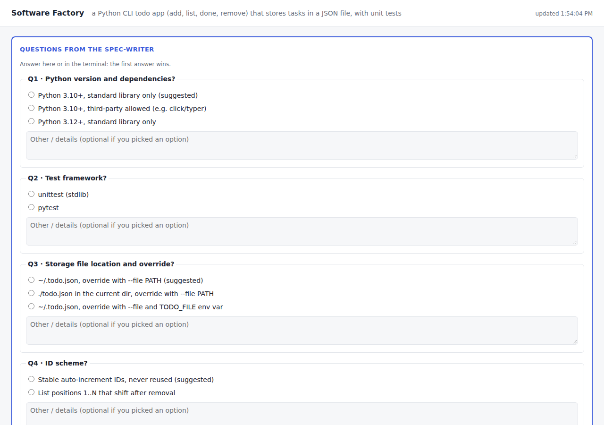
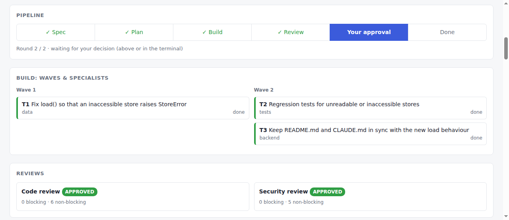
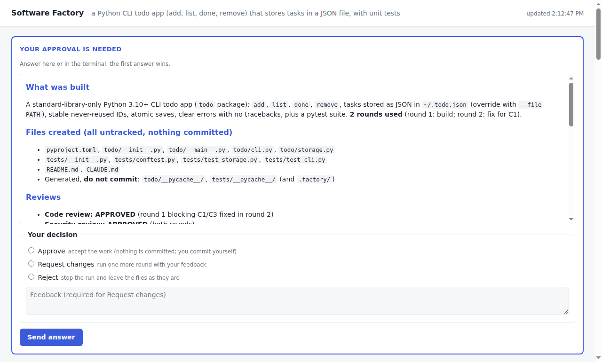

# software-factory

[](https://github.com/lulutalu/software_factory/actions/workflows/ci.yml)
[](LICENSE)

A [Claude Code](https://docs.claude.com/en/docs/claude-code) plugin that turns one command into a small multi-agent software team: a spec writer, a planner, parallel domain specialists, a code reviewer and a security reviewer, with a bounded fix loop and a human approval gate at the end.

```
/factory add a /health endpoint that returns uptime and version
```

> **Status: proof of concept.** I built this to explore how to orchestrate several LLM agents reliably: contracts between agents, parallelism, least privilege, human-in-the-loop. The architecture is complete and the deterministic parts (dashboard server, plugin consistency) are covered by tests in CI. The agent behaviour itself is prompt-driven and has so far been exercised end to end on one small project ([example run](#example-run)). See [Limitations and next steps](#limitations-and-next-steps) for what would be needed to make it production-grade.

## How it works

```
/factory <request>
      │
      ▼
 spec-writer ──(open questions? ask user)──► .factory/spec.md
      │
      ▼
 ┌──► builder (planner) ─────────────────► .factory/plan.md   (tasks, waves, file ownership)
 │        │
 │        ▼
 │   specialists, wave by wave (parallel inside a wave)
 │   frontend · backend · data · tests ──► code + .factory/reports/round-N/
 │        │
 │        ▼
 │   code-reviewer ‖ security-reviewer ──► .factory/review-code.md
 │        │      (in parallel)               .factory/review-security.md
 │        │
 └─ either says CHANGES_REQUESTED (max 2 rounds)
          │ both APPROVED (or 2 rounds used)
          ▼
   user approval: Approve · Request changes · Reject
```

Nothing is ever committed. You review the result and commit it yourself.

Safety checks built into the loop:
- **Plan check:** before any specialist runs, the orchestrator checks `plan.md` (valid specialist, wave and files on every task; no file shared by two tasks in the same wave). If the check fails, the builder gets one retry, then you're asked.
- **Verdict check:** a review whose verdict line can't be read gets one re-run. If it's still unreadable, it counts as CHANGES_REQUESTED and you're told. The dashboard shows it as `INVALID`.
- **Extra rounds:** "Request changes" at the end adds a round beyond the cap (the dashboard shows e.g. `Round 3 / 3`).

## Design decisions

The interesting part of this project is less the prompts than the orchestration around them. The main choices, and why:

| Decision | Why |
|---|---|
| **Orchestration lives in a skill running in the main session, not in an agent** | Claude Code subagents can't spawn subagents. The main session is the only place that can dispatch work, run steps in parallel and talk to the user, so the orchestrator is a skill (`skills/factory/SKILL.md`) and every agent is a leaf worker. |
| **File-based handoffs in `.factory/`** | Subagents start with an empty context. Files (`spec.md`, `plan.md`, reports, reviews, `log.md`) are their shared memory, and they also give a complete audit trail of what each agent saw and decided. |
| **Explicit contracts between agents** | The orchestrator parses specific fields: `specialist:` / `wave:` / `files:` in the plan, and `VERDICT: APPROVED \| CHANGES_REQUESTED` on the first line of each review. The parser is tolerant (blank lines, code fences, case), and a malformed output gets one retry before it fails *closed* (treated as "changes requested"). The same rule is implemented in the dashboard and covered by tests. |
| **Parallelism with file ownership** | The planner groups tasks into waves. Tasks in the same wave run in parallel and must own disjoint file sets, which the orchestrator checks before dispatch. That avoids two agents editing the same file at the same time without needing locks. |
| **Separation of duties / least privilege** | The planner can only write `plan.md`; it never writes production code. The spec writer and both reviewers have no `Edit` tool. Only the reviewers get `Bash` (to run tests and audit tools). Each agent's tool allowlist is set in its frontmatter. |
| **Two independent reviewers** | A code reviewer (spec coverage, tests, correctness, maintainability) and a security reviewer (vulnerabilities, rated by severity) run in parallel with non-overlapping scopes. A round passes only if both approve. |
| **Bounded loop + human gate** | At most 2 automatic build/review rounds, then the user decides (approve / request changes / reject). Reviewers drive the loop, but a human has the final say, and nothing is committed automatically. |
| **Model tiering for cost** | Opus (high effort) for the judgement roles (spec, plan, reviews), Sonnet (medium effort) for the specialists. The specialists do most of the work, often several at once, so that's where most of the token spend goes. |
| **No SDK, native primitives only** | Skills and subagents are enough while the pipeline runs inside a developer's Claude Code session. Moving it to a server, webhook or CI orchestrator is where the Claude Agent SDK would come in (see next steps). |
| **Local dashboard with a hardened write path** | A stdlib-only Python server on `127.0.0.1` shows the run live and lets the user answer the two human-in-the-loop prompts from the browser. The single write endpoint checks Host (DNS rebinding), Origin (CSRF), a per-process random token, content type and size, and validates the answer against the pending question. |

## Example run

[`examples/todo-cli/`](examples/todo-cli/) is the unedited output of one real run (local paths replaced with `<project>`), for the request:

```
/software-factory:factory a Python CLI todo app (add, list, done, remove) that stores tasks in a JSON file, with unit tests
```

- [`.factory/`](examples/todo-cli/.factory/) is the full audit trail: [spec](examples/todo-cli/.factory/spec.md), [plan](examples/todo-cli/.factory/plan.md), every specialist [report](examples/todo-cli/.factory/reports/), both [reviews](examples/todo-cli/.factory/review-code.md), the answered questions and the [step log](examples/todo-cli/.factory/log.md).
- The rest (`todo/`, `tests/`, `pyproject.toml`, `README.md`, `CLAUDE.md`) is the code the agents wrote. CI installs it and runs its 63 tests on every push.

What happened, from [`log.md`](examples/todo-cli/.factory/log.md):

1. **Spec:** the spec-writer listed 10 open questions with suggested defaults; they were answered from the dashboard.
2. **Round 1:** 4 tasks in 2 waves (storage + CLI in parallel, then tests + docs in parallel). The tests specialist reported a **blocker** (pytest wasn't installed) instead of claiming success; it continued after pytest was installed.
3. **Review 1:** security approved (only Low/Info findings). The code reviewer **blocked** on a real bug even though 53/53 tests passed: `load()` used `Path.exists()`, which on Python 3.13+ hides permission errors, so an unreadable store looked empty.
4. **Round 2:** the builder planned *only* the fix, its regression tests and the doc updates. Tests went from 53 to 63, and both reviewers approved.
5. **Approval:** approved by the user. Nothing was committed by the pipeline.

Observations from this run that feed into [next steps](#limitations-and-next-steps): 10 questions is a lot for a small CLI; the orchestrator asked for a few confirmations that `SKILL.md` doesn't call for; and one acceptance criterion (`pip install` in a venv) couldn't be checked in the agent's environment, so it was handed to the user as a manual check (CI now runs it).

## Live dashboard

When a run starts, `/factory` launches a small local web page and prints its URL (by default `http://127.0.0.1:8765/`; the next free port is used if that one is busy). The page updates every 2 seconds and shows:
- the current step and round,
- the waves of tasks and each specialist's status,
- both review verdicts with blocking / non-blocking counts,
- every file in `.factory/` (spec, plan, reports, reviews, log), rendered.


*The spec-writer's open questions, answered from the dashboard during a real run (sample request: a Python CLI todo app).*


*Round 2 of the same run: the code reviewer had blocked round 1 on a bug in `load()`, so the builder planned only the fix (wave 1) and its regression tests and docs (wave 2, in parallel). Both reviewers then approved.*


*The final human gate: the orchestrator's summary and the Approve / Request changes / Reject choice.*

**Answering from the browser:** when the spec-writer has open questions, or at the final approval, a "Your input is needed" panel appears at the top of the page (and the tab title shows ●). You can answer there **or** in the terminal: the first answer wins. Everything else on the page is read-only.

It needs only `python3` (standard library), listens on `127.0.0.1` only (answers need a random per-page token, a same-origin request and the right Host header, so other websites can't answer for you), and stops by itself after 30 minutes without visitors. To stop it earlier, run `kill <pid>` (the PID is in `.factory/ui.json`).

To open the dashboard on a past run by hand (from the root of this repository):
```bash
python3 ui/server.py --factory-dir /path/to/project/.factory
```

## Install

Requirements: [Claude Code](https://docs.claude.com/en/docs/claude-code) and `python3` (for the optional dashboard).

```bash
git clone https://github.com/lulutalu/software_factory.git
```

**Try it for one session (no install):**
```bash
claude --plugin-dir /path/to/software_factory
```

**Install it for every project** (inside Claude Code):
```
/plugin marketplace add /path/to/software_factory
/plugin install software-factory@software-factory-local
```
Restart Claude Code after installing. After you edit the plugin, run `/plugin update software-factory@software-factory-local` (or `claude plugin update …`) and restart again.

## Usage

From any project directory:
```
/software-factory:factory add a /health endpoint that returns uptime and version
```
(Plugin skills are namespaced. If no other skill is called `factory`, `/factory` also works.)

The pipeline creates a `.factory/` folder in the target project with all handoff files. Add it to that project's `.gitignore` if you don't want it tracked.

## Agents

| Agent | Role | Can edit code? | Model / effort |
|---|---|---|---|
| `spec-writer` | Turns the request into requirements (R…) and acceptance criteria (A…), and lists open questions | No (writes `spec.md` only) | opus / high |
| `builder` | Architect/planner: splits the spec into tasks assigned to specialists, in waves, with per-file ownership | No (writes `plan.md` only) | opus / high |
| `frontend` | UI, components, styling | Yes, only the files it owns | sonnet / medium |
| `backend` | Server/API/CLI logic | Yes, only the files it owns | sonnet / medium |
| `data` | Schemas, migrations, queries | Yes, only the files it owns | sonnet / medium |
| `tests` | Tests for acceptance criteria; runs the suite | Yes, test files only | sonnet / medium |
| `code-reviewer` | Spec coverage, runs tests, correctness and maintainability review | No (writes `review-code.md` only) | opus / high |
| `security-reviewer` | Vulnerability audit with severity ratings, dependency audit | No (writes `review-security.md` only) | opus / high |

The `/factory` orchestrator itself is not pinned: it uses your session's `/model` and effort.

## Repository layout

```
.claude-plugin/        plugin manifest + local marketplace
skills/factory/        SKILL.md: the orchestrator
agents/                one file per subagent (prompt + tools + model)
ui/                    dashboard server, page and answer watcher (Python stdlib)
tests/                 unit tests for the dashboard and plugin consistency
examples/todo-cli/     output of one real run: .factory/ audit trail + generated code
docs/images/           dashboard screenshots from that run
.github/workflows/     CI: tests on Python 3.10 / 3.13, the example's own tests, `claude plugin validate`
```

## Development

```bash
python3 -m unittest discover -s tests -v   # dashboard + plugin consistency tests
claude plugin validate .                   # Claude Code's own manifest checks
```

Both run in [GitHub Actions](.github/workflows/ci.yml) on every push and pull request, together with the example run's generated test suite. CI covers only deterministic code. It does not run the agents, because that would need an API key and isn't deterministic.

## Customising

- **Add a specialist:** create `agents/<name>.md` (copy an existing specialist), then add it to the specialist table in `agents/builder.md` and the agent table in `skills/factory/SKILL.md`.
- **Change an agent's model or effort:** edit `model:` (`opus`, `sonnet`, `haiku`, `inherit` or a full model ID) and `effort:` (`low`, `medium`, `high`, `xhigh`, `max`) in its frontmatter in `agents/<name>.md`. `claude plugin validate` doesn't check these values, but `tests/test_plugin.py` does.
- **Change the loop cap:** edit "max 2 rounds" in `skills/factory/SKILL.md` (Step 2 heading, the `round = …` loop, the `round < 2` / `round = 2` rules, the frontmatter description and `max_rounds` in the `status.json` example).
- **Change the dashboard:** `ui/index.html` (page), `ui/server.py` (API) and `ui/wait_answer.py` (answer watcher). The page reads `.factory/status.json` and `.factory/inbox/pending.json`; both formats are defined in `skills/factory/SKILL.md`.
- **Change what blocks a review:** edit the verdict rules in `agents/code-reviewer.md` and `agents/security-reviewer.md`. A round passes only if **both** approve. Currently blocking:
  - *code-reviewer*: test failures, spec not fully implemented, specialist notes/blockers (tool warnings like lint are reported but don't block), correctness bugs, serious maintainability problems.
  - *security-reviewer*: any Medium, High or Critical finding (Low/Info are reported only).

  The reviewers only decide whether another round runs; you still make the final call.

## Limitations and next steps

This is a proof of concept. What it would need before being used for real work:

- **Rules enforced by the platform, not only by prompts.** File ownership, "never commit" and the plan format are instructions to the model. Claude Code hooks (e.g. a `PreToolUse` hook that refuses an `Edit` outside the task's `files:` list) would turn them into hard guarantees.
- **Evaluation.** No benchmark of requests with expected outcomes, so there's no way yet to measure whether a prompt change makes the pipeline better or worse. An eval suite run in CI would be the next big step.
- **Observability and cost.** `log.md` and `status.json` show progress but not token usage, cost or time per agent. These matter for choosing model tiers and setting budgets.
- **Resume and failure handling.** A run that stops halfway (crash, closed session) can't be resumed from its `.factory/` state; it has to start over.
- **Headless / platform mode.** The pipeline needs an interactive Claude Code session. Running it as a service (triggered by an issue, a webhook or CI) would mean porting the orchestrator to the Claude Agent SDK and replacing the terminal/browser prompts with an approval API.
- **Fewer, sharper questions.** The spec-writer should use its own suggested defaults for minor choices and ask only about decisions that really matter. The orchestrator should also stick to the prompts defined in `SKILL.md`.
- **Scope.** Tested on small, single-repository features. Large codebases would need better context selection for each specialist.

## License

[MIT](LICENSE)
